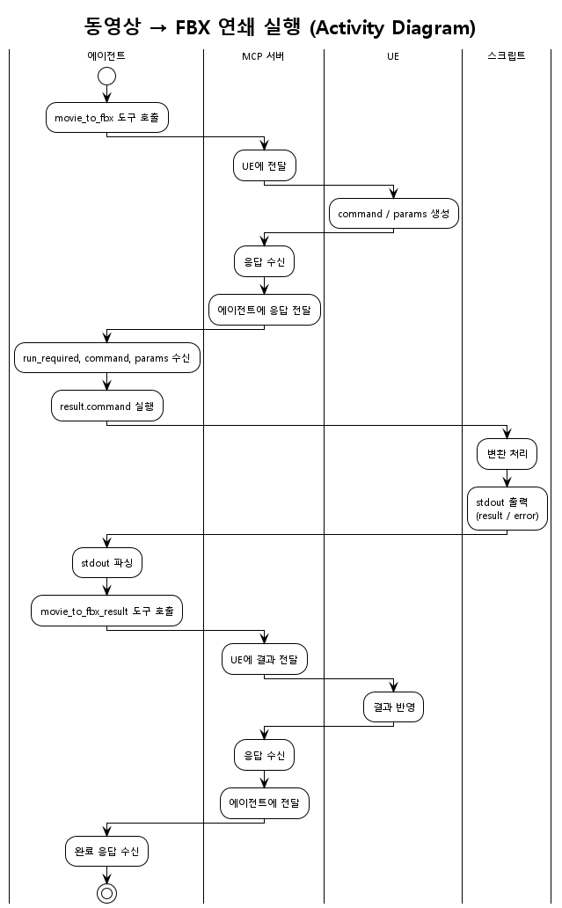

# MCP · UE · 에이전트 연쇄 실행 — Case Study

**다양한 상황**에서 MCP 서버·UE·에이전트가 연쇄적으로 동작할 때의 패턴과 JSON-RPC 2.0 스키마 패턴을 사례별로 정리한다.

---

## 1. 연쇄 실행 시나리오 예: 동영상 → FBX

정형화된 규칙(§3)과 Case별 스키마를 이해하기 쉽도록, **대표 시나리오**를 먼저 단계별로 둔다.  
사용자/에이전트가 "동영상을 FBX로 바꿔 달라"고 요청했을 때, MCP·UE·에이전트가 어떻게 연쇄 동작하는지다.

### 1.1 흐름 다이어그램

동영상→FBX 연쇄에서 **누가 어떤 액션을 하는지** UML Activity Diagram으로 정리했다.



### 1.2 흐름 요약

| 순서 | 주체 | 동작 |
|:----:|------|------|
| 1 | 에이전트 | **movie_to_fbx** 도구 호출 (params는 비어 있거나 일부만 넘김). |
| 2 | MCP 서버 | 호출을 UE에 전달 (예: `ue_send_command("movie_to_fbx", …)`). |
| 3 | UE | 작업을 처리한 뒤, MCP 서버에 **"이 명령을 실행하라"**는 응답을 JSON-RPC 2.0으로 반환. 응답에는 실행할 **한 줄 명령**(`command`)과 그 인자(`params`)가 들어 있음. |
| 4 | MCP 서버 | UE 응답을 그대로 **movie_to_fbx** 도구의 응답으로 에이전트에게 전달. 이때 `result.status = "run_required"`, `result.command`, `result.params` 등이 채워져 있음. |
| 5 | 에이전트 | `result.command`를 실행 (예: `uv run python movie_to_fbx.py --skeleton_path … --movie_path … --fbx_path …`). |
| 6 | 스크립트(movie_to_fbx.py) | 처리 후 stdout **한 줄**에 JSON-RPC 2.0 Response만 출력. 성공이면 `result`에 `success`, `fbx_path`, `message` 등, 실패면 `error`에 `code`, `message`. |
| 7 | 에이전트 | stdout 마지막 줄을 파싱한 뒤, **movie_to_fbx_result** 도구를 호출. params에는 파싱한 `result` 또는 `error` 내용을 그대로 담음. |
| 8 | MCP 서버 | **movie_to_fbx_result** 호출을 UE에 전달. UE가 결과를 반영하고 MCP 서버에 응답. |
| 9 | MCP 서버 | UE 응답을 에이전트에게 전달. 연쇄 종료. |

### 1.3 이 시나리오에서 등장하는 것들

- **movie_to_fbx**: 에이전트가 처음 호출하는 도구. 응답에 "실행할 명령"이 있으면 `status = "run_required"`, `command`, `params`가 옴.
- **result.command / result.params**: UE가 내려준 실행 지시. 에이전트는 이걸 실행한 뒤 그 결과를 다음 도구로 보고함.
- **movie_to_fbx.py stdout**: 스크립트가 출력하는 JSON-RPC 2.0 Response 한 줄. `result`가 있으면 성공, `error`가 있으면 실패.
- **movie_to_fbx_result**: 에이전트가 스크립트 실행 결과를 UE 쪽에 보고할 때 쓰는 도구. params에 stdout에서 파싱한 내용을 담음.

이 순서와 역할을 알고 나면, 아래 **§3 정형화된 규칙**에서 "movie_to_fbx 응답일 때", "stdout에 result가 있으면" 같은 문장이 어떤 단계를 말하는지 바로 대응할 수 있다.

---

## 2. 공통 전제

- **에이전트**: 사용자 요청을 받아 MCP 도구를 호출하고, 필요 시 외부 명령(스크립트 등) 실행.
- **MCP 서버**: 도구 호출을 받아 UE에 전달하거나, UE로부터 지시/결과를 받아 에이전트에게 전달.
- **UE**: 에디터 내 작업을 수행하고, MCP 서버에 요청/응답을 JSON-RPC 2.0 형식으로 보냄.

모든 메시지는 **JSON-RPC 2.0** (Request/Response/Error) 형식을 따른다.

**Request 식별**: 에이전트가 보내는 도구 Request에서는 **`method` 값과 `id` 값을 동일하게 둔다.** (예: `method`: `"movie_to_fbx"`, `id`: `"movie_to_fbx"`) 이렇게 하면 "무슨 동작인지" 하나의 이름으로만 구분할 수 있어 에이전트가 헷갈리지 않는다.

**정형화된 규칙**: 에이전트(LLM)가 오인하지 않도록, 다음 동작은 **status 값과 스펙에 정의된 고정 필드**로만 결정한다. `next_action` 같은 자유 형식 필드는 사용하지 않는다. 자세한 허용 status·동작 규칙은 아래 **§3 정형화된 규칙** 참고.

---

## 3. 정형화된 규칙 (status·동작)

에이전트(LLM)가 **해석 없이** 따를 수 있도록, **status 값과 고정 필드**만으로 다음 동작이 결정되도록 규칙을 정형화한다.  
아래 규칙에서 말하는 **movie_to_fbx**, **movie_to_fbx_result**, **result.command**, **stdout** 등은 모두 **§1 연쇄 시나리오**에서 정의한 흐름과 대응한다.

### 3.1 원칙

- **다음에 할 일은 반드시 `result.status`(또는 `error` 존재 여부)로만 결정한다.**
- 허용되는 `status` 값과 각 status에 대한 **단일 동작**을 스펙에 정의한다.
- 필드 이름은 스펙에 정의된 것만 사용한다. (예: `run_required` → `result.command`, `result.params`)

### 3.2 movie_to_fbx 연쇄에서의 허용 status 및 동작

#### movie_to_fbx 도구 응답 (MCP → 에이전트)

| result.status | 의미 | 에이전트가 할 일 (고정) |
|---------------|------|--------------------------|
| `run_required` | 실행할 명령이 있음 | 1) `result.command` 실행. 2) stdout 마지막 줄을 JSON-RPC 2.0으로 파싱. 3) 파싱 결과에 `result`가 있으면 성공, `error`가 있으면 실패로 간주. 4) **무조건** `movie_to_fbx_result` 도구를 호출하고, params에 파싱한 전체 객체의 `result` 또는 `error` 내용을 그대로 담는다. |

**필수 필드 (status = run_required일 때)**  
- `result.command`: 실행할 한 줄 명령.  
- `result.params`: 스크립트에 넘긴 인자 정보 (선택적으로 명령 조합·검증용).

**그 외 status**  
- 응답에 `error`가 있으면 요청 실패. 연쇄 실행하지 않음.

#### movie_to_fbx.py stdout (스크립트 → 에이전트)

스크립트는 **항상 JSON-RPC 2.0 Response 한 줄**만 출력한다. 별도 status 필드는 두지 않는다. **`id`는 `null`**로 둔다. (스크립트는 Request를 받는 쪽이 아니라, 에이전트가 실행한 프로세스의 출력이므로 대응할 요청 id가 없음.)

| 출력 형태 | 의미 | 에이전트가 할 일 (고정) |
|-----------|------|--------------------------|
| `"result"` 키가 있음 | 성공 | `movie_to_fbx_result`를 호출하고, params에 `success: true`, `fbx_path`, `message` 등 stdout의 `result` 내용을 그대로 담는다. |
| `"error"` 키가 있음 | 실패 | `movie_to_fbx_result`를 호출하고, params에 `success: false`, `error`: { code, message } 등 stdout의 `error` 내용을 그대로 담는다. |

**정형 규칙 요약**  
- stdout에 `result`가 있으면 → 성공으로 `movie_to_fbx_result` 호출.  
- stdout에 `error`가 있으면 → 실패로 `movie_to_fbx_result` 호출.  
- `next_action` 등 추가 필드는 사용하지 않으며, 에이전트는 위 두 가지 경우만 구분하면 된다.

#### 추가 연쇄(성공 후 다른 도구 호출)가 필요한 경우

"movie_to_fbx_result 보고한 뒤, 다음으로 이 도구를 호출해라"를 표현하려면 **movie_to_fbx_result의 응답**에서 **status로만** 표현한다.

| result.status | 의미 | 에이전트가 할 일 (고정) |
|---------------|------|--------------------------|
| (없음 또는 기본) | 완료 | 추가 동작 없음. |
| `follow_up_required` | 추가 도구 호출 필요 | `result.then_method`에 지정된 도구를, `result.then_params`를 params로 호출한다. |

**필수 필드 (status = follow_up_required일 때)**  
- `result.then_method`: string. 호출할 MCP 도구/메서드 이름.  
- `result.then_params`: object. 해당 도구에 넘길 params.

이렇게 하면 "다음 액션"도 **status + 고정 필드(then_method, then_params)** 로만 표현되며, LLM이 해석할 자유 형식 필드는 없다.

### 3.3 정형 규칙 요약

- **다음 동작 = status로만 결정.** 허용 값: `run_required`, (선택) `follow_up_required`.  
- **고정 필드만 사용:** `command`, `params`, `then_method`, `then_params`. `next_action` 미사용.  
- 에이전트 규칙은 위 표에만 따르면 되며, "status가 X이면 Y를 한다"를 그대로 구현하면 된다.

---

## 4. Case 1: 단순 동기 도구 (한 번에 결과 반환)

**상황**: 에이전트가 도구를 호출하면, MCP 서버가 UE에 물어보고 UE가 즉시 결과를 돌려준다. 에이전트는 한 번의 도구 호출로 최종 결과를 받는다.

**흐름**  
에이전트 → `tool_request` → MCP → UE → MCP → `tool_response` → 에이전트

**스키마 패턴**
- **Request**: `method`, `params`, `id` (단, **`id` = `method`** 와 동일한 값으로 둠)
- **Response**: `result` (또는 `error`), `id` (Request의 `id`와 동일)

**JSON-RPC 2.0 예시**

Request (에이전트 → MCP):
```json
{
  "jsonrpc": "2.0",
  "method": "get_current_level_name",
  "params": {},
  "id": "get_current_level_name"
}
```

Response (MCP → 에이전트, 성공):
```json
{
  "jsonrpc": "2.0",
  "result": {
    "level_name": "MainLevel",
    "path": "/Game/Maps/MainLevel"
  },
  "id": "get_current_level_name"
}
```

Response (실패):
```json
{
  "jsonrpc": "2.0",
  "error": {
    "code": -32000,
    "message": "No level loaded."
  },
  "id": "get_current_level_name"
}
```

**적용 예**: "현재 레벨 이름 알려줘", "선택된 액터 목록 반환" 등 단순 조회.

---

## 5. Case 2: 위임 실행 (Run-Required)

**상황**: 도구 호출의 "결과"가 곧바로 나오지 않고, **"이 명령을 실행한 뒤, 그 결과를 다른 도구로 보고하라"**는 지시가 반환된다. 에이전트가 외부 프로세스(스크립트, CLI)를 실행하고, 그 결과를 다시 MCP 도구로 보고한다.

**흐름**  
1. 에이전트 → `movie_to_fbx` → MCP → UE  
2. UE → MCP: "이 인자로 `movie_to_fbx.py` 실행하라"  
3. MCP → 에이전트: `result.status=run_required`, `result.command`, `result.params`  
4. 에이전트가 `result.command` 실행 → stdout 파싱  
5. 에이전트 → `movie_to_fbx_result`(params=파싱 결과) → MCP → UE  
6. MCP → 에이전트: `result.received` 등

**스키마 패턴**
- **첫 도구 Response**: `result.status = "run_required"`, `result.command`, `result.params`
- **실행 결과**: stdout 한 줄을 JSON-RPC 2.0 Response로 출력 (스크립트 측 규약)
- **결과 보고 도구 Request**: 위 결과를 그대로 `params`에 담아 호출

**JSON-RPC 2.0 예시**

1) Request (에이전트 → MCP, movie_to_fbx):
```json
{
  "jsonrpc": "2.0",
  "method": "movie_to_fbx",
  "params": {},
  "id": "movie_to_fbx"
}
```

2) Response (MCP → 에이전트, run_required):
```json
{
  "jsonrpc": "2.0",
  "result": {
    "status": "run_required",
    "message": "Run the command below, then report result via movie_to_fbx_result.",
    "command": "uv run python movie_to_fbx.py --skeleton_path F:\\sk.json --movie_path F:\\v.mp4 --fbx_path F:\\out.fbx",
    "params": {
      "skeleton_path": "F:\\sk.json",
      "movie_path": "F:\\v.mp4",
      "fbx_path": "F:\\out.fbx",
      "overwrite": false
    }
  },
  "id": "movie_to_fbx"
}
```

3) 스크립트 stdout (한 줄, 성공):
```json
{"jsonrpc":"2.0","result":{"success":true,"fbx_path":"F:\\out.fbx","message":"Done"},"id":null}
```

4) Request (에이전트 → MCP, movie_to_fbx_result):
```json
{
  "jsonrpc": "2.0",
  "method": "movie_to_fbx_result",
  "params": {
    "success": true,
    "fbx_path": "F:\\out.fbx",
    "message": "Done"
  },
  "id": "movie_to_fbx_result"
}
```

5) Response (MCP → 에이전트):
```json
{
  "jsonrpc": "2.0",
  "result": { "received": true },
  "id": "movie_to_fbx_result"
}
```

**적용 예**: movie_to_fbx, 바이너리/스크립트 실행 후 결과를 UE에 반영하는 모든 경우.

---

## 6. Case 3: 비동기 수락 + 나중에 결과 알림

**상황**: 요청을 받으면 "접수됨"만 반환하고, 실제 작업은 UE나 백그라운드에서 진행된다. 완료 시 UE가 MCP 서버에 알리고, MCP 서버가 에이전트에게 알리거나 에이전트가 폴링한다.

**흐름 (알림 방식)**  
1. 에이전트 → `long_running_task` → MCP → UE  
2. MCP → 에이전트: `result.status=accepted`, `result.request_id`  
3. (시간 경과) UE 작업 완료 → UE → MCP: `task_completed` (request_id, result)  
4. MCP가 에이전트에게 알림 또는 에이전트가 `get_task_result(request_id)` 호출  
5. MCP → 에이전트: `result` (최종 결과)

**스키마 패턴**
- **첫 Response**: `result.status = "accepted"`, `result.request_id` (또는 `job_id`)
- **완료 알림/폴링 Response**: `result.status = "completed"`, `result.data` 또는 `error`

**JSON-RPC 2.0 예시**

1) Request (에이전트 → MCP):
```json
{
  "jsonrpc": "2.0",
  "method": "bake_lighting",
  "params": { "quality": "high" },
  "id": "bake_lighting"
}
```

2) Response (접수만, MCP → 에이전트):
```json
{
  "jsonrpc": "2.0",
  "result": {
    "status": "accepted",
    "request_id": "req-abc-123",
    "message": "Bake started. Poll get_task_result or wait for notification."
  },
  "id": "bake_lighting"
}
```

3) 폴링 Request:
```json
{
  "jsonrpc": "2.0",
  "method": "get_task_result",
  "params": { "request_id": "req-abc-123" },
  "id": "get_task_result"
}
```

4) Response (완료됨):
```json
{
  "jsonrpc": "2.0",
  "result": {
    "status": "completed",
    "request_id": "req-abc-123",
    "data": { "duration_sec": 120, "output_path": "F:\\..." }
  },
  "id": "get_task_result"
}
```

**적용 예**: 대용량 빌드, 베이킹, 에셋 임포트 등 시간이 걸리는 작업.

---

## 7. Case 4: 다단계 워크플로 (여러 도구 순차 실행)

**상황**: 한 번의 사용자 의도가 여러 단계로 나뉘고, 각 단계가 서로 다른 도구 또는 UE 작업에 대응한다. 중간 결과가 다음 단계의 입력이 될 수 있다.

**흐름**  
에이전트 → tool_A → MCP → UE → result_A → 에이전트 → tool_B(params=result_A 일부) → … → 최종 result

**스키마 패턴**
- 각 도구는 **입력 params**와 **출력 result**를 명확히 정의.
- 다음 도구의 `params`에 이전 도구의 `result` 필드를 매핑할 수 있도록 필드명·타입을 맞춤.
- 필요 시 `result.next_step` 또는 `result.suggested_tool`로 "다음에 호출할 도구"를 명시.

**JSON-RPC 2.0 예시**

1단계 Request:
```json
{
  "jsonrpc": "2.0",
  "method": "resolve_movie_path",
  "params": { "user_input": "intro_cutscene" },
  "id": "resolve_movie_path"
}
```

1단계 Response (result가 다음 단계 입력으로 사용됨):
```json
{
  "jsonrpc": "2.0",
  "result": {
    "movie_path": "F:\\Content\\Movies\\intro_cutscene.mp4",
    "suggested_tool": "movie_to_fbx",
    "params_for_next": {
      "movie_path": "F:\\Content\\Movies\\intro_cutscene.mp4"
    }
  },
  "id": "resolve_movie_path"
}
```

2단계 Request (위 result 일부를 params로):
```json
{
  "jsonrpc": "2.0",
  "method": "movie_to_fbx",
  "params": {
    "movie_path": "F:\\Content\\Movies\\intro_cutscene.mp4",
    "fbx_path": "F:\\Content\\Animations\\intro_cutscene.fbx"
  },
  "id": "movie_to_fbx"
}
```

**적용 예**: "동영상 선택 → 포즈 추출 → FBX 생성 → 시퀀스에 배치"처럼 단계가 나뉜 파이프라인.

---

## 8. Case 5: UE 주도 vs 에이전트 주도

**UE 주도**: 사용자가 UE 내에서 버튼/메뉴를 누르면 UE가 MCP 서버에 "에이전트에게 이 작업을 시키라"고 요청. MCP 서버가 에이전트 세션에 작업을 넣거나, 이미 대기 중인 에이전트에게 메시지로 전달.

**에이전트 주도**: 사용자가 채트/에이전트에게 "동영상을 FBX로 바꿔줘"라고 하면 에이전트가 `movie_to_fbx` 도구를 호출. MCP 서버가 UE에 전달하고, UE가 응답하면 위임 실행 등으로 이어짐.

**스키마 패턴**
- **UE → MCP** 요청: `method`로 "에이전트에게 할 일" 식별, **`id` = `method`** (동일 값), `params`에 인자. (JSON-RPC 2.0 Request 또는 Notification)
- **MCP → 에이전트**: 해당 요청을 도구 호출 형태로 변환하거나, 별도 채널(알림)로 전달. 응답 형식은 동일하게 JSON-RPC 2.0 유지.

**JSON-RPC 2.0 예시**

UE → MCP (UE 주도):
```json
{
  "jsonrpc": "2.0",
  "method": "request_agent_task",
  "params": {
    "task": "movie_to_fbx",
    "skeleton_path": "F:\\sk.json",
    "movie_path": "F:\\v.mp4",
    "fbx_path": "F:\\out.fbx"
  },
  "id": "request_agent_task"
}
```

MCP → UE (수락):
```json
{
  "jsonrpc": "2.0",
  "result": { "accepted": true, "agent_notified": true },
  "id": "request_agent_task"
}
```

(에이전트 주도 시에는 에이전트가 `movie_to_fbx` 도구를 호출하는 Request가 먼저 나가며, 포맷은 Case 2와 동일.)

---

## 9. Case 6: 에러 전파 및 재시도

**상황**: 어느 단계에서든 실패할 수 있다. UE 실패, 스크립트 실패, 타임아웃 등. 에러를 JSON-RPC 2.0 `error` 객체로 통일하고, 필요 시 상위로 전파한다.

**스키마 패턴**
- **error**: `{ "code": number, "message": string, "data": optional }`
- **code**: `-32602` Invalid params, `-32000` 서버/실행 오류, `-32603` Internal error 등. 필요 시 `data`에 `step`, `request_id`, `retry_after` 등 추가.
- **연쇄 시**: 각 레이어가 받은 `error`를 그대로 또는 요약해 상위 Response의 `error`에 담아 반환. 에이전트는 `error`가 있으면 재시도/사용자 안내 등 결정.

**JSON-RPC 2.0 예시**

1) 스크립트 실패 시 stdout (한 줄):
```json
{"jsonrpc":"2.0","error":{"code":-32602,"message":"skeleton_path not found: F:\\missing.json"},"id":null}
```

2) MCP → 에이전트 (에러 전파):
```json
{
  "jsonrpc": "2.0",
  "error": {
    "code": -32000,
    "message": "movie_to_fbx script failed.",
    "data": {
      "script_error_code": -32602,
      "script_message": "skeleton_path not found: F:\\missing.json",
      "step": "movie_to_fbx_result"
    }
  },
  "id": "movie_to_fbx_result"
}
```

3) 재시도 가능 시:
```json
{
  "jsonrpc": "2.0",
  "error": {
    "code": -32000,
    "message": "UE not ready.",
    "data": { "retry_after_sec": 5 }
  },
  "id": "bake_lighting"
}
```

**적용 예**: 모든 연쇄 호출. 스키마에 "실패 시 error 객체 필수"로 두고, 도구 설명에 에러 코드 문서 링크를 두면 LLM이 문맥으로 활용하기 좋다.

---

## 10. Case 7: 파라미터가 나중에 채워지는 경우

**상황**: 에이전트가 처음에는 경로나 옵션을 모르고 도구만 호출. UE가 "이 경로로 실행하라"고 내려주면 그때 비로소 `command`·`params`가 채워진다 (movie_to_fbx와 동일).

**스키마 패턴**
- **첫 도구 Request**: `params` 비어 있거나 최소한만 (예: `{}` 또는 `{ "intent": "movie_to_fbx" }`).
- **첫 도구 Response**: UE가 내려준 내용으로 `result.params`, `result.command` 등이 채워진 상태로 반환.
- 도구 스키마 설명에 "첫 호출 시 params는 선택이며, UE가 내려준 run_required 응답에 실제 params가 담긴다"고 명시.

**JSON-RPC 2.0 예시**

1) Request (params 없이 또는 intent만):
```json
{
  "jsonrpc": "2.0",
  "method": "movie_to_fbx",
  "params": {},
  "id": "movie_to_fbx"
}
```

2) Response (UE가 경로를 채워서 반환):
```json
{
  "jsonrpc": "2.0",
  "result": {
    "status": "run_required",
    "command": "uv run python movie_to_fbx.py --skeleton_path F:\\sk.json --movie_path F:\\v.mp4 --fbx_path F:\\out.fbx",
    "params": {
      "skeleton_path": "F:\\sk.json",
      "movie_path": "F:\\v.mp4",
      "fbx_path": "F:\\out.fbx",
      "overwrite": false
    }
  },
  "id": "movie_to_fbx"
}
```

**적용 예**: UE가 경로·설정을 결정하는 모든 위임 실행.

---

## 11. 스키마 설계 시 공통 원칙

1. **모든 메시지는 JSON-RPC 2.0**  
   - Request: `jsonrpc`, `method`, `params`, `id` (**`id` = `method`** 와 동일한 값)  
   - Response: `jsonrpc`, `result` 또는 `error`, `id` (Request의 `id`와 동일)

2. **상태가 바뀌는 경우 `status` 필드**  
   - `run_required`, `accepted`, `completed`, `failed` 등으로 다음 동작을 구분.

3. **연쇄를 위해 필요한 최소 필드**  
   - "무엇을 실행할지": `command` 또는 `params`  
   - "어떤 요청에 대한 결과인지": `request_id` / `id`  
   - "성공/실패": `result` vs `error` 또는 `result.success`

4. **도구 스키마와 문서에 명시**  
   - 각 도구의 Request/Response 스키마를 표로 정리 (예: `MCP-movie-to-fbx-schemas.md`).  
   - "이 도구 응답에 `run_required`가 있으면, 에이전트는 `result.command`를 실행한 뒤 `movie_to_fbx_result`를 호출한다"처럼 **연쇄 규칙**을 글로 적어 두면 LLM·구현자 모두 일관되게 따른다.

---

## 12. 요약 표

| Case | 설명 | 첫 응답의 핵심 | 다음 단계 |
|------|------|----------------|-----------|
| 1. 단순 동기 | 한 번에 결과 반환 | `result`에 최종 데이터 | 없음 |
| 2. 위임 실행 | "명령 실행 후 결과 보고" | `result.status=run_required`, `result.command`, `result.params` | 스크립트 실행 → 결과 도구 호출 |
| 3. 비동기 수락 | 접수 후 나중에 완료 | `result.status=accepted`, `result.request_id` | 알림 수신 또는 폴링 |
| 4. 다단계 워크플로 | 여러 도구 순차 | 각 도구 `result`가 다음 도구 `params`로 | 다음 도구 호출 |
| 5. UE/에이전트 주도 | 누가 시작하느냐만 다름 | 동일 스키마, 방향만 다름 | 동일 |
| 6. 에러 전파 | 실패 시 일관된 형식 | `error`: code, message, (data) | 상위로 전파 또는 재시도 |
| 7. 나중에 params 채움 | UE가 경로 등 결정 | `result.params`에 실제 값 | 위임 실행과 동일 |

이 문서는 **movie_to_fbx** 외에도 새로운 연쇄 시나리오를 설계할 때 참고용으로 사용할 수 있다.

---

## 13. 정형화된 JSON-RPC 2.0 스키마 목록

Case Study에서 사용하는 **정형화된 메시지별 스키마**를 표로 정리한다. 모든 메시지는 JSON-RPC 2.0 기준이다.

### 공통 구조

| 구분 | 필수 필드 | 비고 |
|------|-----------|------|
| **Request** | `jsonrpc`: `"2.0"`, `method`: string, `params`: object, `id` | **`id` = `method`** (동일 문자열) |
| **Response (성공)** | `jsonrpc`: `"2.0"`, `result`: object, `id` | `id`는 대응 Request의 `id`와 동일 |
| **Response (실패)** | `jsonrpc`: `"2.0"`, `error`: { `code`, `message` }, `id` | `error.data` 선택 |

---

### Case 1: 단순 동기

| 메시지 | 방향 | 필드 요약 |
|--------|------|-----------|
| 도구 Request | 에이전트 → MCP | `method`, `params` (비어 있거나 조회 인자), **`id`: `method`와 동일** |
| Response (성공) | MCP → 에이전트 | `result`: 도구별 데이터 (예: `level_name`, `path`), `id` |
| Response (실패) | MCP → 에이전트 | `error`: { `code`, `message` }, `id` |

---

### Case 2: 위임 실행 (run_required)

| 메시지 | 방향 | 필드 요약 |
|--------|------|-----------|
| movie_to_fbx Request | 에이전트 → MCP | `method`: `"movie_to_fbx"`, `params` (선택), **`id`: `"movie_to_fbx"`** |
| movie_to_fbx Response (성공) | MCP → 에이전트 | `result.status`: `"run_required"`, `result.command`, `result.params` (skeleton_path, movie_path, fbx_path, overwrite), `id` |
| movie_to_fbx Response (실패) | MCP → 에이전트 | `error`: { `code`, `message` }, `id` |
| 스크립트 stdout (성공) | 스크립트 → 에이전트 | `result`: { `success`: true, `fbx_path`, `message` }, `id`: null |
| 스크립트 stdout (실패) | 스크립트 → 에이전트 | `error`: { `code`, `message` }, `id`: null |
| movie_to_fbx_result Request | 에이전트 → MCP | `method`: `"movie_to_fbx_result"`, `params`: stdout의 result/error 내용 (success, fbx_path, message 또는 error), **`id`: `"movie_to_fbx_result"`** |
| movie_to_fbx_result Response | MCP → 에이전트 | `result`: { `received` 등 }, `id` |

---

### Case 3: 비동기 수락

| 메시지 | 방향 | 필드 요약 |
|--------|------|-----------|
| 장시간 작업 Request | 에이전트 → MCP | `method`, `params` (예: quality), **`id`: `method`와 동일** |
| Response (접수) | MCP → 에이전트 | `result.status`: `"accepted"`, `result.request_id`, `result.message`, `id` |
| get_task_result Request | 에이전트 → MCP | `method`: `"get_task_result"`, `params`: { `request_id` }, **`id`: `"get_task_result"`** |
| Response (완료) | MCP → 에이전트 | `result.status`: `"completed"`, `result.request_id`, `result.data`, `id` |
| Response (진행 중) | MCP → 에이전트 | `result.status`: `"running"`, `result.request_id`, `result.progress`, `id` |

---

### Case 4: 다단계 워크플로

| 메시지 | 방향 | 필드 요약 |
|--------|------|-----------|
| 1단계 도구 Request | 에이전트 → MCP | `method`, `params` (단계별 입력), **`id`: `method`와 동일** |
| 1단계 Response | MCP → 에이전트 | `result`: 단계 결과 + 선택적 `suggested_tool`, `params_for_next`, `id` |
| 2단계 도구 Request | 에이전트 → MCP | `method`, `params`: 이전 result 필드 매핑, **`id`: `method`와 동일** |

---

### Case 5: UE 주도

| 메시지 | 방향 | 필드 요약 |
|--------|------|-----------|
| request_agent_task Request | UE → MCP | `method`: `"request_agent_task"`, `params`: { `task`, ...인자 }, **`id`: `"request_agent_task"`** |
| Response (수락) | MCP → UE | `result`: { `accepted`, `agent_notified` }, `id` |

---

### Case 6: 에러 전파

| 메시지 | 방향 | 필드 요약 |
|--------|------|-----------|
| Response (에러) | 공통 | `error`: { `code`, `message`, `data`?(선택) }, `id` |
| error.data (선택) | — | `step`, `request_id`, `script_error_code`, `script_message`, `retry_after_sec` 등 |

**에러 코드**: `-32602` Invalid params, `-32000` 서버/실행 오류, `-32603` Internal error.

---

### Case 7: params 나중에 채움

| 메시지 | 방향 | 필드 요약 |
|--------|------|-----------|
| 도구 Request (최소) | 에이전트 → MCP | `method`, `params`: {} 또는 { `intent` }, **`id`: `method`와 동일** |
| Response (run_required) | MCP → 에이전트 | Case 2와 동일: `result.status`, `result.command`, `result.params` |

---

### 추가 연쇄용 (follow_up_required)

| 메시지 | 방향 | 필드 요약 |
|--------|------|-----------|
| movie_to_fbx_result Response (추가 연쇄) | MCP → 에이전트 | `result.status`: `"follow_up_required"`, `result.then_method`, `result.then_params`, `id` |

